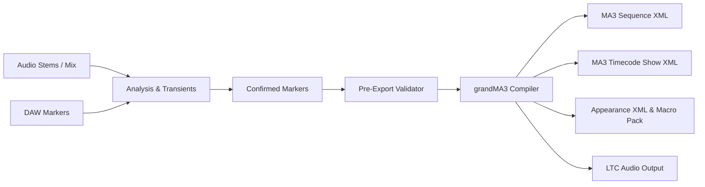

# CueForge ⚡

> **High-precision music marker to grandMA3 2.5.x Sequence & Timecode Show compiler.**

[](LICENSE)
[](https://www.typescriptlang.org/)
[](https://react.dev/)
[](https://vitejs.dev/)
[](https://github.com/Samu-Kiss/CueForge)

**Core Invariant:**  
$$\text{1 Confirmed Marker} \equiv \text{1 grandMA3 Cue} \equiv \text{1 Timecode Event}$$

CueForge bridges music production, audio analysis, and lighting design. It transforms manual transients, DAW markers, and stem-derived musical analysis directly into clean, production-ready **grandMA3 2.5.x** Sequences and synchronized Timecode Shows—without manual timecode event recording or positioning.

---

## ✨ Features

### 🎧 Audio & Stem Analysis
- **Multi-Stem Playback & Mixing:** Load master tracks or isolated stems (Drums, Bass, Vocals, Instruments) with independent gain, mute, and solo controls.
- **Musical Structure Detection:** Analyzes multi-bar energy dynamics, rhythmic density, and instrument entrance/exit patterns to suggest song sections (Intro, Verse, Chorus, Drop, Bridge, Outro).
- **Transient & Accent Detection:** Per-stem audio attack detection with configurable thresholding and spectral peak targeting.
- **Multi-Band Frequency Splitting:** Filter and inspect Sub-bass, Mid, and High-frequency bands in real-time.
- **Metronome, Count-In & Tap Tempo:** Synchronized audio metronome with audible count-in leads and precision tap-tempo calculation.
- **LTC (SMPTE) Timecode Audio Generator:** Synthesizes broadcast-standard Linear Timecode WAV streams matched to your sequence for feeding physical grandMA3 consoles or LTC interfaces.

### ⏱️ Timeline & DAW Interoperability
- **DAW Marker Importers:** Import marker and cue cuepoint files from major DAWs:
  - **REAPER** (CSV / TXT marker exports)
  - **Ableton Live** (Locator cue exports)
  - **Pro Tools** (Session text exports)
  - **Logic Pro** (Marker list exports)
- **High-Precision Waveform Navigation:** Zoomable interactive waveform scrubber with frame-accurate cursor positioning and snap-to-grid capabilities.
- **Bulk Operations:** Batch shift, quantize, re-time, re-label, and toggle export status across entire marker selections.

### 💡 grandMA3 2.5.x Native Compiler
- **Clean Show Generation:** Clears the programmer (`ClearAll`) before cue storage to ensure cue placeholders contain zero residual attribute values, leaving programmer space clean for look development.
- **Exact Tick Calculation:** Converts SMPTE timecodes to grandMA3 2.5.x native internal tick resolution ($$1\text{ second} = 16,777,216\text{ ticks}$$) avoiding floating-point rounding drift.
- **Frame Rate Support:** Native frame-accurate timecode generation for **24 fps**, **25 fps**, **29.97 fps (Drop-Frame)**, and **30 fps**.
- **Deterministic Event Destination:** Employs target-specific `Go+` commands linked explicitly with `CueDestination`, ensuring scrubbing or jumping anywhere on the timeline reliably triggers the correct cue state. Optional `Goto(Status)` mode supported.
- **Appearance & Color Tagging:** Automatically exports MA3 Appearance XML definitions with visual color coding matching cue categories (Structure, Hit, FX, Notes).
- **All-in-one ZIP Export:** Bundles MA3 XML show files, sequence macros, appearance assets, and README deployment instructions into a single download.

### 💾 Projects & Persistence
- **Local Browser Storage:** Auto-saves your ongoing session via IndexedDB without server dependence.
- **Self-Contained Archives (`.cueforge`):** Export and share complete portable project archives containing all markers, audio stems, mixer states, and export configurations.

---

## 🏗️ Architecture & Export Pipeline



### Export Rules & Validation
1. **Single Source of Truth (`src/core/compiler.ts`)**:
   - Every confirmed marker generates exactly 1 sequentially numbered Cue (`Cue 1`, `Cue 2`, ...) and 1 Timecode Event targeting that exact cue.
   - Beat grids are strictly isolated from markers and never exported as cues unless explicitly promoted.
2. **Cue Parameters**:
   - Trigger type defaults strictly to `Go` (`Set Sequence X Cue Y Property "TrigType" "Go"`).
   - Preserves custom split `CueFade` and `CueDelay` timings.
3. **Pre-Export Validation (`src/core/validator.ts`)**:
   - Asserts $\text{Cue Count} == \text{Exportable Marker Count} == \text{Timecode Event Count}$.
   - Verifies explicit sequence/cue ID integrity, frame alignment, and overwrite protection.

---

## 🚀 Getting Started

### Prerequisites
- [Node.js](https://nodejs.org/) (version 18 or higher recommended; v20+ preferred)
- [npm](https://www.npmjs.com/)

### Installation

```bash
# Clone the repository
git clone https://github.com/Samu-Kiss/CueForge.git
cd CueForge

# Install dependencies
npm install
```

### Running the Development Server

```bash
npm run dev
```

Open [http://localhost:5173](http://localhost:5173) in your browser.

### Running Tests

CueForge includes a comprehensive test suite (90+ unit and integration tests) powered by [Vitest](https://vitest.dev/):

```bash
# Run tests once
npm test

# Run tests in watch mode
npm run test:watch
```

### Building for Production

```bash
npm run build
```

The compiled static assets will be output to the `dist/` directory.

---

## ⌨️ Keyboard Shortcuts

| Shortcut | Action |
| :--- | :--- |
| `Space` | Play / Pause audio playback |
| `M` | Add marker at current playhead position |
| `Ctrl / Cmd + S` | Save current project locally |
| `Ctrl / Cmd + Shift + S` | Download complete `.cueforge` project archive |
| `Left / Right Arrow` | Scrub playhead (frame step) |
| `Shift + Left / Right` | Jump to previous / next marker |

---

## 📦 Tech Stack

- **Framework:** React 18
- **Language:** TypeScript 5.6
- **Build Tool:** Vite 6
- **Icons:** Lucide React
- **Archive Generation:** JSZip
- **Test Runner:** Vitest + Fake-IndexedDB
- **Styling:** Custom CSS with CSS variables and responsive audio controls

---

## 📄 License

This is free and unencumbered software released into the public domain under **[The Unlicense](LICENSE)**. Anyone is free to copy, modify, publish, use, compile, sell, or distribute this software, in source code or compiled binary form, for any commercial or non-commercial purpose.
